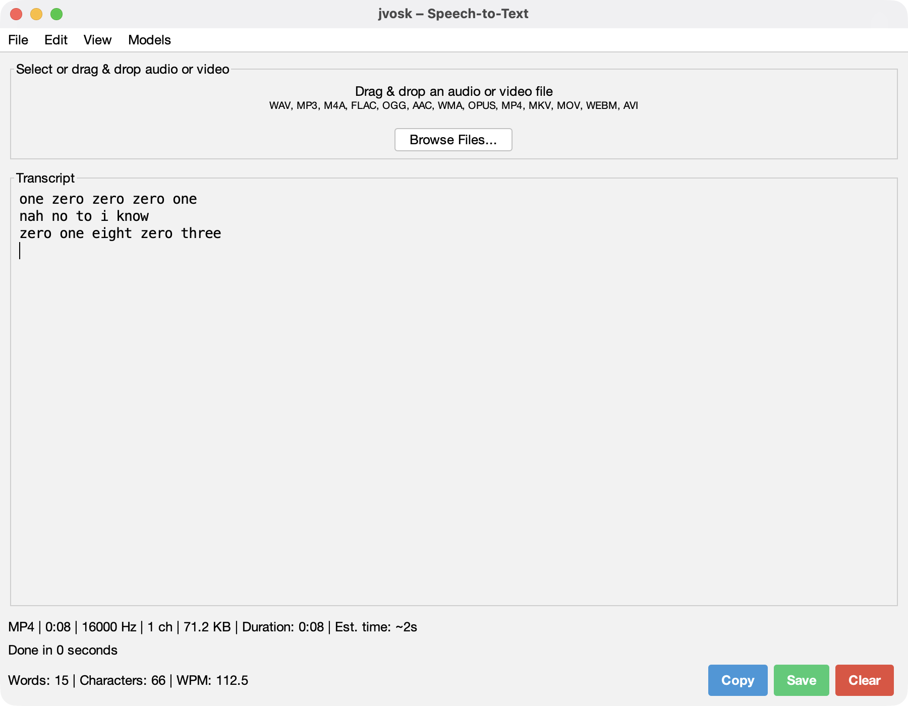
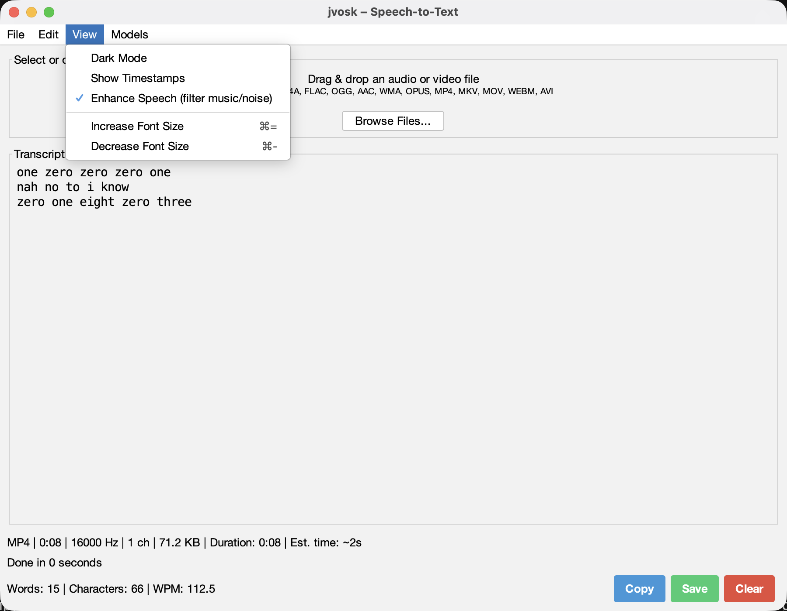
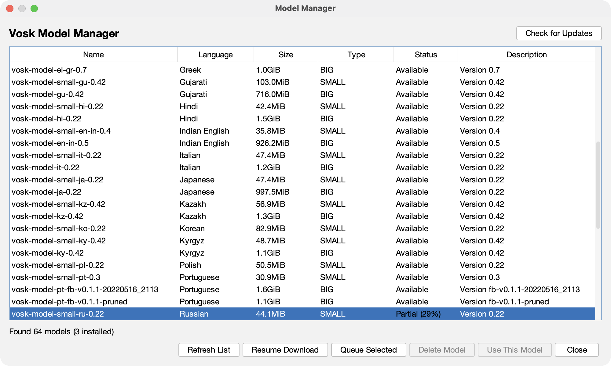
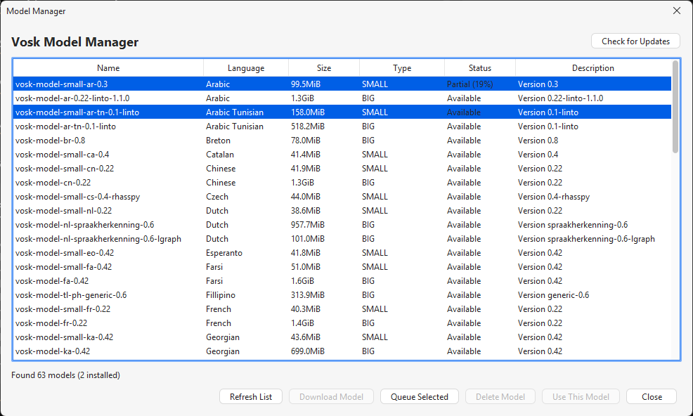
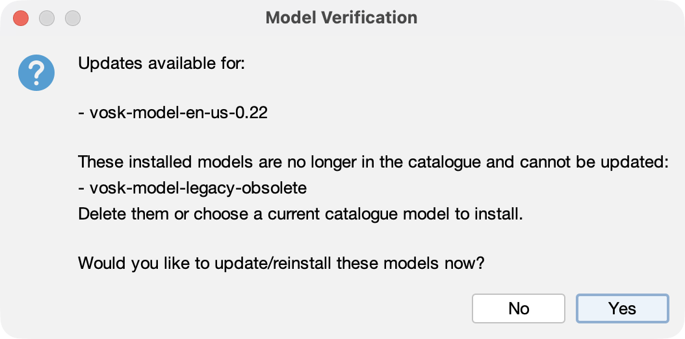
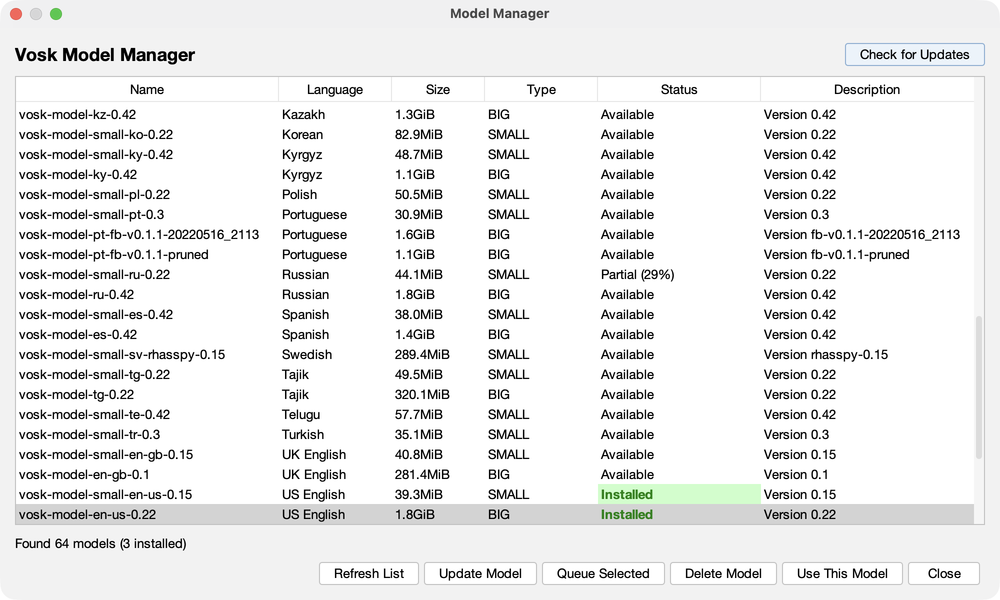
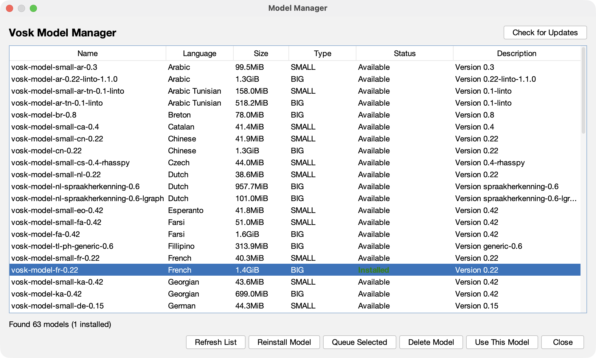
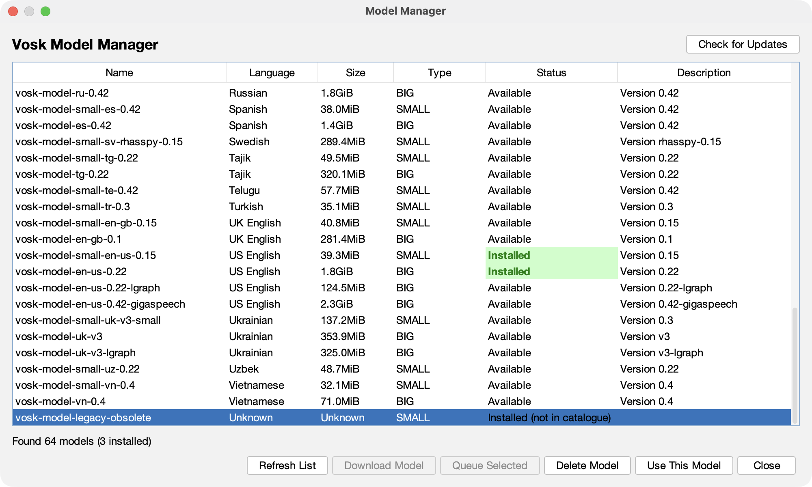
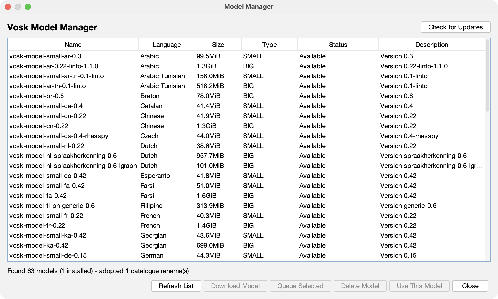

# jvosk


[Icon, wordmark, and brand assets](assets/brand/README.md)


Modern desktop application for speech-to-text transcription using Vosk offline speech recognition.

Built with Java Swing and FlatLaf for a polished, cross-platform UI with **multi-model support**.


[Download 0.1.0-SNAPSHOT](https://github.com/palaashatri/jvosk/releases/download/0.1.0-SNAPSHOT/jvosk-0.1.0-SNAPSHOT.jar)

>**Made for macOS 🍎** 

> **Looks decent on Windows too :) 🪟** 


## Features

### Model Management
- **Multi-Model Support**: Download and manage multiple Vosk models
- **Machine-Readable Catalogue**: Uses Vosk's official `model-list.json`, with a bundled snapshot when offline
- **60+ Current Models**: Speech-to-text models across 35 languages; obsolete, speaker-ID and TTS entries are excluded
- **Verified Downloads**: Exact size and MD5 checks before a model is installed
- **Resume and Queue**: Interrupted downloads retain partial bytes; queue several models and see partial progress
- **Real Update Checks**: Saved catalogue version, archive size and checksum are compared against the latest catalogue
- **Catalogue Rename Adoption**: A checksum-verified install whose folder was renamed upstream is moved to the current catalogue name automatically
- **Honest Orphan Status**: Installs that left the catalogue show **Installed (not in catalogue)** instead of a broken reinstall action
- **Easy Switching**: Switch between models on the fly
- **Smart Downloads**: 
  - Small models for quick downloads
  - Big models with a confirmation prompt
  - Progress tracking for all downloads
- **35 Languages**: English, Chinese, Russian, French, German, Spanish, and many more
- **Model Manager UI**: 
  - View all available models with details (size, language, version)
  - Download new models with progress bar
  - Delete unused models
  - See installed/available status per model

### Audio and video
- **Multiple Formats**: WAV, MP3, M4A, FLAC, OGG, AAC, WMA, OPUS plus video (MP4, MKV, MOV, WEBM, AVI)
- **Automatic Conversion**: Bundled JAVE/FFmpeg extracts audio from video; no host ffmpeg
- **Speech enhance**: optional View-menu filter (speech-band high/low-pass + loudness normalize) to reduce music/noise before recognition
- **Drag & Drop**: Drag audio or video files into the app
- **File Browser**: Standard file picker with format filtering



*An MP4 video is converted and transcribed offline; the status line reports the model and completion time.*



*Optional speech-band filtering is toggled from the View menu before transcription.*

### Transcription
- **Offline Processing**: No internet required, privacy-first
- **Real-time Progress**: Visual feedback during transcription
- **Accurate Results**: Powered by Vosk speech recognition
- **Optional Timestamps**: Add `[HH:MM:SS]` timestamps to each segment

### Export Options
- **Plain Text** (.txt)
- **Subtitle Formats** (SRT, VTT)
- **Structured Data** (JSON)
- **Markdown** (.md)

### User Interface
- **Modern Design**: Clean, professional interface with FlatLaf
- **Dark Mode**: System-aware dark/light theme toggle
- **Keyboard Shortcuts**: Streamlined workflow
  - `Cmd/Ctrl+O` - Open file
  - `Cmd/Ctrl+S` - Save transcript
  - `Cmd/Ctrl+N` - Clear/New
  - `Cmd/Ctrl+Shift+C` - Copy to clipboard
  - `Cmd/Ctrl+Shift+M` - Manage models
  - `Cmd/Ctrl+±` - Adjust font size
- **Statistics**: Word count, character count, WPM
- **Recent Files**: Quick access to previously transcribed files
- **Audio Info**: Display duration, format, sample rate
- **Progress Tracking**: Real-time transcription progress

### Quality of Life
- **Copy to Clipboard**: One-click copy of transcription
- **Cancel Anytime**: Stop long transcriptions mid-process
- **Unsaved Changes Warning**: Never lose work accidentally
- **Persistent Preferences**: Remembers your settings and selected model
- **Adjustable Font**: Customize text size for comfort

## Roadmap

In priority order — each is something a user would notice:

1. **Live transcription from the microphone.** Vosk is built for streaming recognition; show words as they are spoken.
2. **Word-level timing and confidence:** highlight low-confidence words in the transcript and use word times for tighter SRT/VTT cues (Vosk returns both).
3. **Batch transcription:** drop a folder, get a queue with per-file progress and one transcript per file.
4. **A real 1.0.0 release:** cut an annotated signed tag (`git tag -s v1.0.0`); GitHub Actions builds per-OS jars and `jpackage` installers and publishes them as release assets. Native packages are unsigned.

### Recently completed

- Replaced fragile HTML scraping with Vosk's machine-readable catalogue and a bundled offline snapshot.
- Added exact download-size and MD5 verification, staged extraction and rollback-safe installation.
- Added JUnit 5 golden-file tests for every export format and a cross-platform CI workflow.
- Persisted catalogue version, archive size and checksum for new installs; update checks compare known metadata.
- Added an atomic, validated catalogue refresh script (`python scripts/update-model-catalogue.py`).
- Added cross-platform native model load/transcription integration tests with an attributed WAV fixture.
- Added resumable HTTP Range downloads, partial-download status and sequential queueing in Model Manager.
- Switched JAVE to OS/architecture-specific FFmpeg dependencies; the Windows shaded jar is about 56 MB (previous all-platform build: about 225 MB).
- Seeded `.jvosk-install.json` stubs for legacy model folders without copying unverified catalogue identity.
- Persisted the Model Manager download queue across restarts; cancelled queues can be resumed.
- Added Swing tests for update/reinstall labels, queue cancellation leftovers and partial-download status.
- Added a signed-tag release workflow that publishes `jpackage` installers.
- Video files (MP4/MKV/MOV/WEBM/AVI) transcribe through bundled JAVE FFmpeg; optional **Enhance Speech** filters music/noise.
- Adopted catalogue renames for checksum-verified installs and marked installs that left the catalogue as **Installed (not in catalogue)**.

## Quick Start

### Requirements
- Java 17 or higher
- Maven 3.8+
- No additional dependencies needed!

### Build & Run

```bash
# Clone the repository
git clone https://github.com/palaashatri/jvosk.git
cd jvosk

# Build the project and run unit tests
mvn clean verify

# Run the application
mvn exec:java
```

### Tests and CI

```bash
mvn -B verify

# Optional network/native integration test (downloads the 39.3 MiB test model)
mvn -B -Pintegration-tests verify
```

The unit suite covers catalogue parsing and offline fallback, install metadata/update detection, legacy metadata migration, archive integrity, resumable downloads, persisted download queues, zip-slip protection, Model Manager update/reinstall/partial-download UI behaviour, and golden-file exports. The integration profile downloads a small official English model, installs and loads it, then transcribes the attributed short WAV fixture. GitHub Actions runs the integration profile on Linux, macOS and Windows with JDK 17 and uploads a platform-specific shaded jar from each runner. Annotated signed `vX.Y.Z` tags additionally build `jpackage` installers and publish a GitHub release.

Refresh the bundled catalogue intentionally (Python 3 required), review the JSON diff, then commit it with the snapshot date:

```bash
python scripts/update-model-catalogue.py
```

### First Use

1. Launch the app
2. Open **Models → Manage Models...** (`Cmd/Ctrl+Shift+M`)
3. Download a model for your language:
   - For English: `vosk-model-small-en-us-0.15` (40MB) or `vosk-model-en-us-0.22` (1.8GB)
   - For other languages, browse the available models
4. Click "Download Model" and wait for completion
5. Select the downloaded model and click "Use This Model"
6. Click "Browse Files..." or drag & drop an audio file
7. Wait for transcription to complete
8. Save or copy your transcript!

## Model Management

### Accessing Model Manager

- **Menu**: Models → Manage Models...
- **Keyboard**: `Cmd/Ctrl+Shift+M`

### Available Models

The app reads Vosk's official machine-readable catalogue
([`model-list.json`](https://alphacephei.com/vosk/models/model-list.json)) and
falls back to a bundled snapshot when the catalogue cannot be fetched. The
current snapshot contains **63 current speech-to-text models across 35
languages**; obsolete models and archives this app cannot use (speaker-ID,
text-to-speech) are filtered out.

**Popular Languages:**
- **English**: US English, UK English and Indian English models
- **Chinese**: 2 models
- **Russian**: 2 models
- **French**: 2 models
- **German**: 2 models
- **Spanish**: 2 models
- **Japanese**: 2 models
- **And 25+ more languages!**

**Model Types:**
- **Small Models**: Size-optimised, good for mobile/desktop, lightweight
- **Big Models**: Higher accuracy, more memory and disk space

### Downloading Models

1. Open Model Manager
2. Browse available models in the table
3. Select a model
4. Click "Download Model"
5. Wait for download and extraction (progress shown)
6. Model is automatically installed and ready to use

Downloads are written to a resumable partial file and verified against the
exact archive size and MD5 checksum from the catalogue before extraction.
Select multiple models and choose **Queue Selected** for sequential downloads.
Cancelled or interrupted transfers appear as **Partial** and resume when
queued again. Unfinished queues are written to
`~/.jvosk/models/.jvosk-download-queue.json` and offered for resume the next
time Model Manager opens. Large models show a confirmation prompt before downloading.



*Interrupted transfers stay visible as **Partial (29%)** with **Resume Download** enabled; the status column names the exact partial percentage.*



*Unfinished queues survive restarts and are offered for resume the next time Model Manager opens.*

### Switching Models

**Quick Switch:**
1. Menu: Models → Switch Model...
2. Select from installed models
3. Confirm selection

**Or via Model Manager:**
1. Open Model Manager
2. Select an installed model
3. Click "Use This Model"

### Model Updates

- **Check for Updates** compares persisted catalogue version, checksum and
  exact archive size against the current catalogue.
- Catalogue renames are adopted automatically. If an installed folder is no
  longer in the catalogue but its saved checksum matches exactly one catalogue
  archive (and that name is free), the folder is moved to the catalogue name and
  its metadata is rewritten. Ambiguous, missing or mismatched checksums are
  never moved.
- Legacy folders get a `.jvosk-install.json` stub on startup so they are
  recognised, but catalogue version/size/checksum are not copied from the
  name. A reinstall is still required before update checks can trust them.
- Installed models that left the catalogue are marked **Installed (not in
  catalogue)**. They can still be used or deleted, but no reinstall or update
  is offered because there is no catalogue archive to download.
- Updates are never applied automatically. Select an updated model and choose
  **Update Model**, or add it to the queue. Staged installation keeps the old
  model unless the new archive verifies and extracts successfully.



*Update checks report catalogue updates separately from installs the catalogue no longer lists.*



*Updated models can be applied directly or added to the sequential queue.*



*An installed model that is still in the catalogue but has no saved checksum offers **Reinstall Model**.*



*Installs the catalogue no longer lists are labelled **Installed (not in catalogue)**; only Delete and Use remain.*



*A folder renamed upstream is moved to the new catalogue name and reported in the status line.*

### Deleting Models

1. Open Model Manager
2. Select an installed model
3. Click "Delete Model"
4. Confirm deletion

## Technical Details

### Architecture

**Core Components:**
- `VoskModel`: Immutable model metadata, including an exact byte size and optional MD5 checksum
- `ModelRegistry`: Loads and validates Vosk's JSON catalogue, filters unsupported/obsolete entries, and falls back to the bundled snapshot
- `ModelManager`: Persists install metadata; resumes partial downloads, verifies size/checksum, stages extraction, and installs with rollback
- `ModelManagerDialog`: UI for managing models (catalogue and download work runs off the Swing EDT)
- `VoskTranscriber`: Converts audio and runs recognition with the selected model

**Model Storage:**
- Models are stored in `~/.jvosk/models/` (`%USERPROFILE%\.jvosk\models` on Windows)
- Each model is in its own subdirectory named after the catalogue entry
- Models use the standard Vosk format and can be used with other Vosk tools

**Catalogue Fallback:**
- `src/main/resources/atri/palaash/jvosk/models/model-list.json` is a snapshot
  of the official catalogue (generated 2026-10-24)
- It is used only when the remote catalogue cannot be fetched or parsed
- The Model Manager shows when the bundled catalogue is in use
- Refresh it with `python scripts/update-model-catalogue.py`; the script validates and atomically replaces the resource.

**Platform builds:** Maven activates a matching `jave-nativebin-*` profile for
the host OS and CPU. The shaded jar therefore contains that platform's FFmpeg
binary rather than every platform binary. GitHub Actions retains separate
Linux, macOS and Windows jars. Supported profiles are Windows x86/x64, Linux
x64/ARM32/ARM64, and macOS x64/ARM64.

### Dependencies

```xml
<dependencies>
    <!-- Core speech recognition -->
    <dependency>
        <groupId>com.alphacephei</groupId>
        <artifactId>vosk</artifactId>
        <version>0.3.38</version>
    </dependency>
    
    <!-- UI framework -->
    <dependency>
        <groupId>com.formdev</groupId>
        <artifactId>flatlaf</artifactId>
        <version>3.4.1</version>
    </dependency>
    
    <!-- Audio conversion -->
    <dependency>
        <groupId>ws.schild</groupId>
        <artifactId>jave-core</artifactId>
        <version>3.5.0</version>
    </dependency>
    
    <!-- JSON catalogue parsing -->
    <dependency>
        <groupId>com.fasterxml.jackson.core</groupId>
        <artifactId>jackson-databind</artifactId>
        <version>2.17.1</version>
    </dependency>

    <!-- Tests -->
    <dependency>
        <groupId>org.junit.jupiter</groupId>
        <artifactId>junit-jupiter</artifactId>
        <version>5.11.4</version>
        <scope>test</scope>
    </dependency>
</dependencies>
```

OS-specific `jave-nativebin-*` dependencies are selected by Maven profiles in
`pom.xml` and included in the shaded jar for the build host.

## Technology Stack

- **Speech Recognition**: [Vosk](https://alphacephei.com/vosk/)
- **Audio Processing**: [JAVE2](https://github.com/a-schild/jave2) (FFmpeg wrapper)
- **UI Framework**: Java Swing with [FlatLaf](https://www.formdev.com/flatlaf/)
- **Build Tool**: Maven

## License

MIT

## Contributing

Contributions welcome! Please open an issue or submit a pull request.

## Future SLOPOS desktop, PARAMA and low-memory targets

**Planned, not implemented:** jvosk is an independently authored candidate for the optional SLOPOS Dictation provider, complementary to JWhisper. Target supported **Linux/SLOPOS** desktop integration first; any native **PARAMA/SURYA** port depends on the real kernel, runtime, graphics/input, filesystem and native-library requirements specified in [AGENTS.md](AGENTS.md#future-sloposparama-integration-and-pi-zero-2-w-efficiency-goals). The aim is high-quality useful work on constrained hardware, not a claim that every heavy workload fits.

**Pi Zero 2 W (512 MB, quad Cortex-A53) profile:** Prefer compact Vosk models verified on-device; stream microphone/audio and emit partial transcription without retaining entire decoded PCM in memory. Bound waveform previews, temp files and thread count. Preflight model download/decompression plus Java heap/native Vosk usage within 512 MB headroom and fail early if impossible. No idle microphone or model loading. Validate actual app/runtime compatibility and performance on the board; **no verified Zero 2 W or native PARAMA support is claimed here**. Installation should be optional, with no eager services or model downloads in the lightweight SLOPOS base image.
